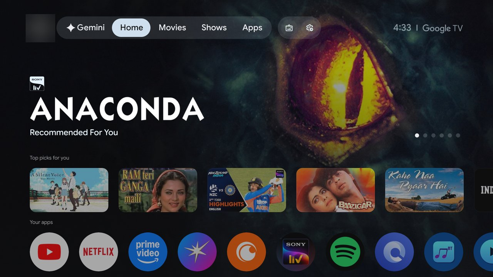
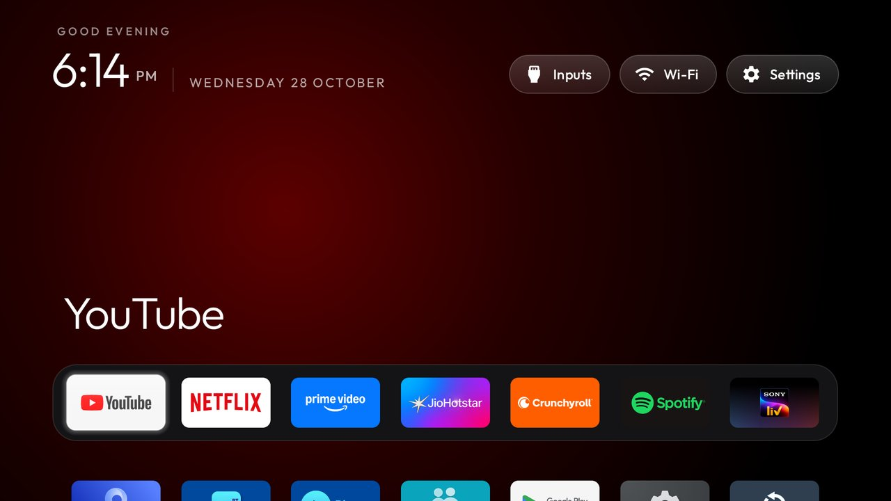

# Clean My TV: Acer AR43GR2851VQD

Removes ads, sponsored rows and telemetry from an Acer Google TV (Acer R4G, Android 14) and replaces the stock home screen
with the [CleanYourTV](https://github.com/Gathin23/cleanyourtv) launcher, while the TV keeps working
as a normal Android TV (Play Store, streaming apps, Chromecast, voice, HDMI/Live TV, OTA updates).
Nothing is uninstalled; everything is reversible.

## Screenshots

| Before: stock Google TV Home | After: CleanYourTV Home (after a cold boot) |
|---|---|
|  |  |

The account picture in the "before" shot is blurred.

| File | What it is |
|---|---|
| [PLAN.md](PLAN.md) | The phased plan, with commands, success checks and rollbacks |
| [BOARD.md](BOARD.md) | Kanban of the tickets |
| [.scratch/acer-tv-cleanup/](.scratch/acer-tv-cleanup/) | PRD (`spec.md`) and tickets (`issues/`) |
| [CONTEXT.md](CONTEXT.md) | Terms used throughout |
| [docs/screenshots/](docs/screenshots/) | Before/after Home screenshots for this README |
| [docs/adr/](docs/adr/) | Decisions: the stock launcher stays, the PowerShell scripts, one growing applied list, lasting-only debloat on the R4G |
| [scripts/health-check.ps1](scripts/health-check.ps1) | Pass/fail gate after every batch |
| `artefacts/` | Backups, lists, restore records, logs, screenshots. **Git-ignored** (it holds device identifiers), except the two debloat lists `acer-debloat-final.txt` (approved) and `acer-debloat.txt` (applied) |
| `cleanyourtv/` | Clone of the upstream repo (git-ignored; re-clone with the command below) |
| [RUNBOOK.md](RUNBOOK.md) | **Start here for maintenance:** restore, after-update check, Home-helper recovery, changing the dock, re-enabling debugging |

## Setup on a new Windows laptop

```powershell
git clone https://github.com/Gathin23/cleanyourtv
python -m venv cleanyourtv\tools\venv
cleanyourtv\tools\venv\Scripts\python.exe -m pip install -r cleanyourtv\tools\requirements.txt
```

Building the launcher also needs JDK 17 (`JAVA_HOME`) and the Android SDK (`ANDROID_HOME`) with
platform 34, build-tools 34.0.0 and platform-tools. See `PLAN.md`, Prerequisites.

## Status

**Done, 2026-10-28.** 9 ad/telemetry packages disabled (they survive cold boots), CleanYourTV on Home, owner-verified, and ADB closed afterwards. See [BOARD.md](BOARD.md) and [RUNBOOK.md](RUNBOOK.md).
